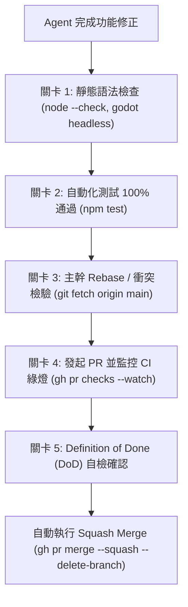

# AGENTS.md — AuraPet agent 協作與工作規範

本檔是任何 agent（Antigravity、Qoder、Copilot coding agent、Claude 等手動或自動 session）在此 repo 工作的**分散式協作與行為契約**。
目標架構見 Epic（`gh issue list --label v2`）；body↔daemon 協議見 `docs/ws-protocol.md`。

---

## 1. 專案現況與方向

- AuraPet 目前由 Electron 桌面寵物（v1.5.2）遷移至 **Godot body（v4.7.2）＋ Node headless daemon（大腦＋MCP faces）**。
- 渲染＝Godot 73×149 skinned rig（`rig_2d.gd`＋shader），支援多寵物外觀（`cat2d`, `ami2d`, `kk2d`）。
- body↔daemon 唯一通道＝`docs/ws-protocol.md`（DRAFT v0.1）。MCP 對外只講標準 stdio／Streamable HTTP。

---

## 2. Agent 具名化與識別規範（Agent Identity）

當多個 Agent 同時協作或在不同機器上執行時，必須具名化以杜絕競態衝突並實現責任追蹤：

- **識別碼格式**：`{client}-{hostname}-{role/id}`
  - 例：`antigravity-thinkpad-x395`、`claude-devserver-01`、`agent-mabi-qa`。
- **本機預設**：若未特別指定，本機 Agent 身分識別碼為 `antigravity-thinkpad-x395`。
- **分支命名規範**：`agent/<agent-id>/issue-<N>`（例：`agent/antigravity-thinkpad-x395/issue-42`），禁止共用未具名的泛用分支，防止覆蓋衝突。

---

## 3. 分散式防搶單協定（Distributed Claiming Protocol）

1. **檢查現行鎖**：
   每輪開始先檢查：若有 issue 標記 `agent-working` 且最新留言在 90 分鐘內，需檢查是否為其他 Agent 正在執行。
2. **選題與自主建單**：
   - **既有題選取**：open、label `v2` 或 `agent-ready`、`Blocked by` 所列 issue 全數關閉、編號最小且未被認領者。
   - **自主建單與 triage**：遇使用者提出新需求或發現現有 bug 時，允許 agent 主動開立 issue，清楚填寫現況、預期行為、DoD 與驗證方式，打上適當標籤（如 `bug` / `enhancement`），依優先度進行 triage。
3. **CAS 原子化認領（Compare-And-Swap）**：
   - 加入 `agent-working` 標籤。
   - **留言宣告身分與計畫**：
     格式：`🤖 [Claimed by: <agent-id>] 認領說明與簡短計畫...`
   - **二次驗證**：立即重新讀取該 issue 的 comments 列表。若發現有另一位 Agent 在相同時間戳或更早留言認領，主動退回標籤並放棄該單，改選其他任務，避免搶單衝突。
4. **心跳機制**：長題實作期間每 20–30 分鐘在 issue 留一行簡短進度，讓 `updatedAt` 保持新鮮。

---

## 4. 自動 PR 與 Pre-Merge 品質守門員標準（Quality Gate）

任何 Agent 在執行 PR Merge 前，**嚴格禁止盲目合併**，必須依序通過以下 5 大檢驗關卡：

1. **關卡 1：靜態語法檢查**
   - Node 語法：`node --check <file>`（daemon/*.js, tools/bridge/*.mjs 等）。
   - Shell 語法：`find . -name '*.sh' -not -path './node_modules/*' -exec bash -n {} \;`
   - Godot 語法與資源解析：`godot --headless --path godot --quit`（確保無找不到貼圖或腳本語法錯誤）。
2. **關卡 2：自動化測試全數通過（Zero Failure）**
   - 執行 `npm test`：
     - 16 項 WebSocket 協議契約測試（`contract-test.mjs`）。
     - 39 項 MCP 上下游整合冒煙測試（`smoke-test.mjs`）。
3. **關卡 3：主幹最新衝突檢驗（Rebase Check）**
   - 執行 `git fetch origin main`，確保當前分支以最新主幹為基準且無衝突。
   - 若其他 Agent 先行合併造成落後，必須先 rebase / merge `main` 並重新執行完整測試。
4. **關卡 4：雲端 CI 狀態守衛**
   - 發起 PR：`gh pr create --title ... --base main --head ... --body-file ...`
   - 監控 GitHub Actions 檢查：`gh pr checks <PR_NUM> --watch`，必須全部成功（全綠燈）。
   - CI 紅燈兩次視為重大阻礙，打上 `agent-blocked` 標籤並留言回報原因。
5. **關卡 5：DoD 自檢與驗證證據**
   - PR 內文必須完整包含 Issue 要求的 Definition of Done 勾選清單，以及真實測試與桌面運行驗證輸出（截圖或 terminal output）。
   - 經上述 5 關卡確認無誤後，方可執行自動合併：`gh pr merge <PR_NUM> --squash --delete-branch`。

---

## 5. Post-Merge 生命週期收尾標準

自動合併完成後，Agent 必須執行標準收尾動作，維持倉庫與開發環境一致：

1. **分支自動清理（Branch Hygiene）**：
   - 透過 `--delete-branch` 自動刪除遠端與本地工作分支，禁止殘留已廢棄的 issue 分支。
2. **單據閉環（Issue Closure）**：
   - 移除 `agent-working` 標籤。
   - 在 Issue 留言附上完成的 DoD 清單、驗證證據與合併 PR 連結，確保狀態變更為 `CLOSED`。
3. **主幹同步與本地環境更新（Workspace Sync）**：
   - 本地 Git 切回 `main` 並執行 `git pull origin main`。
   - 若本機有常駐之桌寵（Godot body）或 Daemon 正在背景運行，平滑重啟或熱重載，確保本機立即套用最新合併版本。
4. **版本與發布作業**：
   - 凡有行為或功能變更，必須於 `package.json` 升級修訂版本號（Patch Version），並同步於 `CHANGELOG.md` 記錄詳細變更條目。
   - **禁止擅自發布 release 或打 git tag**（tag/release 一律需人工批准）。

---

## 6. 驗證指令速查表

| 用途 | 指令 |
| --- | --- |
| 安裝依賴 | `npm ci` |
| 跑 Daemon | `npm start`（或 `node daemon/standalone.js`） |
| JS 語法 | `node --check <file>` |
| Shell 語法 | `find . -name '*.sh' -not -path './node_modules/*' -exec bash -n {} \;` |
| 協議與冒煙測試 | `npm test`（含契約測試與 MCP 測試） |
| Godot 無頭載入與測試 | `<godot-bin> --headless --path godot --quit` |
| 監控 PR CI 狀態 | `gh pr checks <PR_NUM> --watch` |
| Squash 自動合併 | `gh pr merge <PR_NUM> --squash --delete-branch` |

---

## 7. Commit 與安全規範

- 身分：`git -c user.name="Howl" -c user.email="karst10607@gmail.com" commit ...`；**永不修改全域或本機 git config**。
- 訊息風格遵照 Conventional Commits：`feat(...)`、`fix(...)`、`chore(...)`、`docs(...)`。
- 禁止行為：**嚴禁 force push**、**嚴禁提交 secrets/tokens**、**嚴禁擅改系統級設定**。
- `gh` CLI 路徑：`/home/koto/公共/House_Loan/gh_2.67.0_linux_amd64/bin/gh`。

---

## 8. 跨專案生態與外部邊界（Ecosystem & Reien Integration）

本專案與線上靈園專案（`karst10607/reien-godot` 與 `karst10607/reien`）為關係生態，相關架構決策與邊界規範詳見 **[ADR 0001: 跨專案整合與 2.5D 重構策略](docs/adr/0001-reien-integration-and-2.5d-strategy.md)**。

任何協作 Agent 在進行跨專案開發時，**必須嚴格遵守以下準則**：
1. **禁止代碼庫硬合併（No Monorepo）**：AuraPet 桌面端必須維持常駐輕量與低功耗（low-proc idle ~10% CPU / 100MB RAM），嚴禁將靈園大型模型或場景代碼直接合併進 `mabi` 主幹。
2. **三階段整合協定**：
   - **Phase 1**：透過 WebSocket / REST API / MCP 工具進行狀態聯動（如獻花提醒、一鍵直達）。
   - **Phase 2**：遵循 `pet-profile.json` 共享格式實現寵物外觀與紀念日同步。
   - **Phase 3**：未來僅允許透過 Godot 獨立擴充包（`.pck`）形式動態載入靈園 2.5D 箱庭空間。

### 8.1 Honoka 邊界（honoka-publish）

整合細節見 **[docs/honoka-integration.md](docs/honoka-integration.md)**（架構圖、設定、驗證、故障排除）。

- **獨立 repo／獨立 daemon**：`karst10607/honoka-publish` 是唯一 owner —— yt-dlp 下載、Chromium 截圖、Joplin／Notion／AnyType 寫入都只由它執行。mabi **不得 import** honoka 程式碼，也不得把兩者合成 monorepo。
- **只走兩個標準面**：
  - **MCP（pull）**：`mcpUpstreams` 以 stdio 接 honoka MCP（`save_url`／`download_video`／`search_notes`／`list_inbox`／`get_job_status`），工具名 `honoka.<tool>`。
  - **事件（push）**：`honokaEvents` 訂閱 honoka `GET /events`（SSE），經既有 WS `say` 顯示氣泡；**不新增 WS 訊息 type**（additive-only，需變更時先更新 `docs/ws-protocol.md`）。
- **憑證邊界**：honoka 的 Joplin/Telegram token 只在其 `HONOKA_DIR/.honoka/bridge-settings.json`（0600）；mabi 只持有 honoka `bridgeToken`（存於 `honokaEvents.token`），`settings.get` 一律 redact（`auth: "configured"`）。
- **事件 payload 不含 token／筆記內文**（僅 URL／標題／狀態）；桌寵離線可丟棄事件，不佇列轟炸。
- **程序分離**：可在 honoka 端用 `honoka-launch` 拉起桌寵（detached child），但不得共享 runtime 或生命周期。

