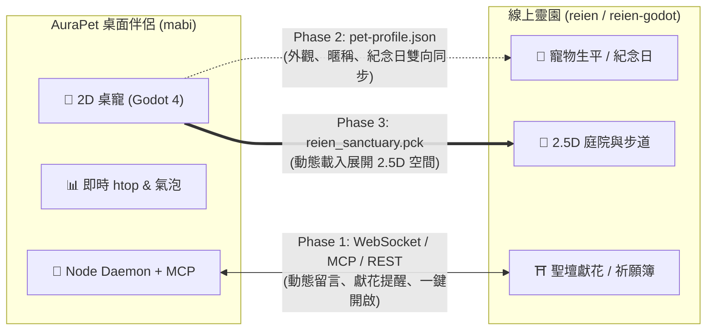

# ADR 0001: AuraPet 桌面夥伴與線上靈園（Reien）跨專案整合與 2.5D 重構架構策略

- **狀態 (Status)**: 已接受 (Accepted)
- **決策者 (Deciders)**: karst10607, Antigravity Agent
- **日期 (Date)**: 2026-11-08
- **關聯儲存庫**:
  - `karst10607/mabi` (AuraPet 桌面伴侶，Godot 4.7.2 Body + Node SEA Daemon + MCP)
  - `karst10607/reien-godot` (線上靈園 Godot 4 客戶端)
  - `karst10607/reien` (線上靈園 WebGL / Three.js 前端與服務端)

---

## 一、背景與問題陳述 (Context & Problem Statement)

AuraPet 目前已成功遷移為輕量級的透明桌面伴侶，具備即時 htop 系統監控、互動音效、多寵物外觀與 MCP 工具支援。
同時，使用者另有線上靈園專案（Reien），該專案提供寵物聖壇追思、線上祭拜、守護犬「豆豆」與日式木造御守所等虛擬空間，目前正計畫進行「2.5D 地圖風格」與「切換場景」之架構重構。

**核心問題**：
1. 兩個專案是否應該合併為單一儲存庫（Monorepo）？
2. 桌面夥伴與線上靈園之間應如何建立情感與數據互動？
3. 線上靈園在進行 2.5D 重構時，應採用何種技術選型以確保低功耗與良好體驗？

---

## 二、決策驅動因素 (Decision Drivers)

1. **效能與資源隔離**：桌面端必須保持長年常駐、低記憶體（~100MB）、低 CPU（idle ~10%），不得受大型場景資產拖累。
2. **開發敏捷度**：靈園的 2.5D 地圖與美術迭代快速，應避免兩邊 CI/CD 與部署流程相互牽制。
3. **用戶體驗一致性**：使用者在桌面能隨時感受到靈園的守護與情感聯動，並能一鍵前往追思空間。
4. **引擎技術共振**：兩者皆已採用 Godot 4.x 作為原生引擎，具備長期共享渲染器與資產包的潛力。

---

## 三、方案比較 (Considered Options)

### 方案 A：程式碼硬合併（Monorepo Hard Merge）
- 將靈園的地圖、模型與場景代碼直接整併進 `mabi`。
- **缺點**：
  - 桌面伴侶安裝包與記憶體佔用暴增數百 MB，違背「輕量常駐」初衷。
  - Git 歷史與 CI 檢查變得沉重，任一方出錯皆會阻礙主幹發布。

### 方案 B：維持獨立儲存庫，採用「鬆耦合通訊與共享資產標準」（Selected）
- 兩專案維持獨立 GitHub Repositories。
- 透過 WebSocket / REST API / MCP 工具實現數據與狀態聯動。
- 制定共享寵物設定檔標準（Shared Profile Schema）。
- **優點**：架構邊界清晰，雙邊可平行獨立迭代，效能完全隔離。

---

## 四、架構決策 (Decision Outcome)

### 1. 儲存庫策略：維持獨立儲存庫（Keep Separate Repositories）
- `mabi` 專注於桌面透明夥伴與 MCP 助理。
- `reien-godot` 與 `reien` 專注於 2.5D 箱庭地圖、聖壇追思與線上漫遊。
- **任何協作 Agent 禁止擅自將兩者程式碼直接合入同一 repo**。

### 2. 跨專案互動三階段推進藍圖 (3-Phase Interaction Blueprint)

- **Phase 1：MCP / API 狀態聯動（即刻實施）**：
  - 系統匣提供「🌸 前往線上靈園」捷徑。
  - 桌寵氣泡隨機呈現靈園動態（如獻花通知、問候守護犬豆豆）。
  - 透過 `daemon/mcp-server.js` 註冊靈園追思工具。
- **Phase 2：寵物資產與檔案共享（Shared Profile）**：
  - 制定通用之 `pet-profile.json` Schema（包含 `skin`、`nickname`、`memorialDate`、`affection`）。
  - 在靈園追思的毛孩可作為桌寵常駐桌面；桌面寵物亦在靈園中擁有專屬庭院紀念碑。
- **Phase 3：Godot PCK 動態載入（終極沉浸形態）**：
  - 將靈園編譯為獨立資源包 `reien_sanctuary.pck`。
  - 平時維持桌面透明小視窗；使用者點擊「探望」時，Godot 本體動態載入該 PCK，平滑全螢幕展開為 2.5D 靈園漫步空間；退出時縮回桌面寵物。

### 3. 線上靈園 2.5D 重構技術指南 (Reien 2.5D Reconstruction)

1. **地圖風格選型**：
   - 推薦**等角斜 45 度（Isometric 2.5D）** 或 **傾角正交俯視**。
   - 營造日式和風庭園、石階步道、石燈常夜燈、鳥居、放生池與木造御守所之「箱庭（Miniature Garden）」精緻溫馨感。
2. **Godot 4 核心技術實作**：
   - 使用 Godot 4.3+ 的 **`TileMapLayer`** 構建等角瓷磚網格。
   - 開啟 **Y-Sort 深度排序**：角色與寵物走到樹木、建築後方自動被遮擋，走到底部前方自動覆蓋，自然呈現層次立體感。
3. **場景切換（Scene Transition）架構**：
   - 建立全域 **`SceneManager`** 控制場景淡入淡出（Fade Transition）。
   - 切換劃分：
     - `WorldScene`（戶外庭園、櫻花步道、放生池、豆豆草坪）。
     - `IndoorScene`（木造御守所、榻榻米追思堂、聖壇供桌）。
     - `MemorialDetail`（個別寵物的追思相片與留言簿介面）。
   - 轉場以柔光/黑幕淡入淡出配合日式風鈴（Furin）或鳥鳴過渡，確保心靈沉澱氛圍。

---

## 五、對各 AI Agent 的行為規範 (Guidance for AI Agents)

任何在此儲存庫（或 `reien-godot` 儲存庫）工作的 AI Agent 必須遵守以下規則：
1. **嚴禁程式庫硬合併**：不得將 `reien` 或 `reien-godot` 的代碼直接提交至 `mabi` 主幹，反之亦然。
2. **跨專案通訊標準**：所有跨專案功能開發，必須依循本 ADR 所述之 WebSocket 協議、REST API 或 MCP 工具對接。
3. **資產變更同步**：若更新寵物模型或定義格式，必須維持向後相容性，不得破壞既有之 `cat2d`、`ami2d`、`kk2d` 配置。
