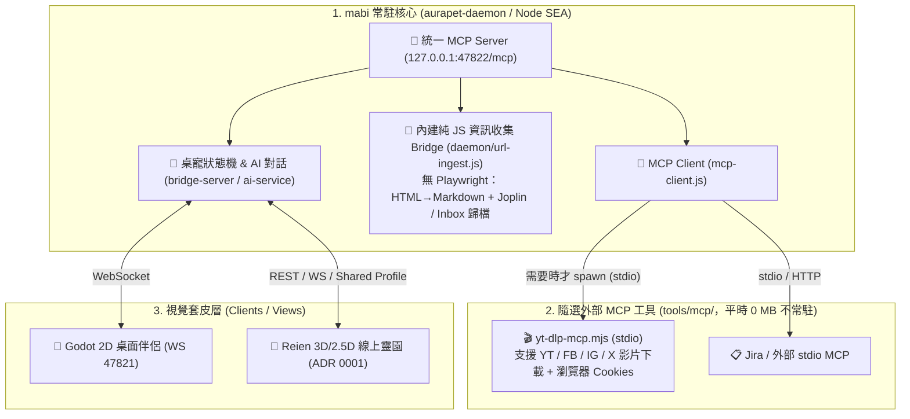

# ADR 0002: 跨平台單一 Daemon 收斂策略與隨選影音 MCP (yt-dlp) 解耦邊界

- **狀態 (Status)**: 已接受 (Accepted) — 修訂並取代原 `AGENTS.md §8.1` 中「必須額外常駐 `honoka-bridge.service`」之限制
- **決策者 (Deciders)**: karst10607, Antigravity Agent
- **日期 (Date)**: 2026-11-10
- **關聯儲存庫**:
  - `karst10607/mabi` (AuraPet 跨平台統一常駐 Daemon + Godot 2D 桌寵 + MCP Hub)
  - `karst10607/reien` / `karst10607/reien-godot` (線上靈園 3D/2.5D 前端空間，維持 ADR 0001 獨立儲存庫)
  - `karst10607/honoka-publish` (早期資訊收集與發布工具集，常駐 Daemon 職責移交至 `mabi`)

---

## 一、背景與問題陳述 (Context & Problem Statement)

在早期架構（見 `docs/honoka-integration.md` 初版與 `AGENTS.md §8.1`）中，為了防止 `honoka-publish` 內部的 **Playwright Chromium（約 300~400 MB）** 與 **`yt-dlp` 外部二進位執行檔** 污染 `mabi` 的輕量 Node SEA 單檔打包（`aurapet-daemon`），規範要求：
1. 必須在系統額外維護一個常駐的 `honoka-bridge.service`（Port 44124）。
2. `mabi` 僅能透過 SSE (`honokaEvents`) 與外部 `mcpUpstreams` 間接通訊。

然而隨著跨平台部署需求演進，維護多個常駐背景 Daemon（`mabi` on 47822、`honoka-bridge` on 44124、Joplin on 41184 等）帶來了 Port 管理、多套 systemd 服務維護與跨平台（Linux / Windows）啟動複雜度。

經重新審視依賴結構後發現：
1. **只要移除 Playwright 整頁截圖強依賴**，原本 `honoka-bridge` 負責的文章擷取、HTML 轉 Markdown、Joplin/Notion 筆記寫入、Jira/Telegram 訊息橋接，底層 **100% 皆為純 JavaScript 與標準 HTTP `fetch` 請求**，打包進 `mabi` 的 `aurapet.cjs` 僅增加不到 50 KB。
2. **YouTube / Facebook / Instagram / X (Twitter) 影片下載（`yt-dlp`）** 屬於偶發的批次 I/O 任務，且各社群平台反爬蟲與 Cookies 規則變動極快，既不應該 24 小時常駐佔用記憶體，也不應該與筆記/桌寵主程式綁死。

---

## 二、決策驅動因素 (Decision Drivers)

1. **單一常駐 Daemon 跨平台體驗**：在 Linux (`systemd --user`) 與 Windows (`aurapet-daemon.exe`) 上，使用者只需啟動一個 `mabi` Daemon，即可同時擁有桌寵大腦、統一 MCP Server 入口與輕量資訊收集 Bridge。
2. **維持極致輕量（~100MB RAM / Node SEA 單一執行檔）**：常駐 Daemon 內部嚴禁引入 Chromium / Playwright / JSDOM 等巨型或原生二進位依賴。
3. **重型與高變動工具隨選化（On-demand Zero-Idle）**：`yt-dlp` 影音下載應僅在需要下載時透過 `stdio` 喚醒，平時常駐記憶體為 0 MB，且修改下載參數（如 `--cookies-from-browser`）不需重編譯 `mabi` 主體。
4. **版圖收斂**：日常開發與維護收斂至 `mabi`（常駐核心 + MCP 工具箱）與 `reien`（3D/2.5D 視覺空間）兩大主軸。

---

## 三、架構決策 (Decision Outcome)

### 1. 移除 Playwright，將純 JS 資訊收集收斂進 `mabi/daemon/`
- `mabi` 常駐 Daemon 直接內建純 JS 網頁文章擷取與筆記歸檔模組（`daemon/url-ingest.js`），透過 MCP 工具 `notes.save_url` 對外提供服務，並直接聯動桌寵 `say` 氣泡（`🔗` / `📝` / `⚠️`）。
- 同時保留 `honokaEvents` (SSE) 相容性：若外部仍有獨立 `honoka-publish` 實例，依然可推播事件，但不再強制要求啟動 `honoka-bridge.service`。

### 2. 影音下載獨立為 `tools/mcp/yt-dlp-mcp.mjs`（On-demand stdio MCP）
- 在 `mabi` 倉庫的 `tools/mcp/yt-dlp-mcp.mjs` 提供標準 stdio MCP 伺服器，專門封裝 `yt-dlp`。
- **不打包進 `aurapet-daemon` 常駐執行檔**：平時不佔用任何背景行程或記憶體。
- **支援多平台與登入態**：支援 YouTube、Facebook (`facebook.com`/`fb.watch`)、Instagram (`instagram.com`)、X (`x.com`/`twitter.com`)、Bilibili、TikTok，並提供 `cookiesFromBrowser` 參數以突破社群平台登入牆。
- 任何 MCP Client（`mabi` 的 `mcpUpstreams`、Antigravity、Cursor、Qoder）皆可直接透過 `stdio` 按需呼叫 `video.download`、`video.info`、`video.status`。

### 3. `reien` 維持 ADR 0001 獨立儲存庫
- 3D/2.5D 靈園場景資產與 WebGL/Godot 渲染器維持在 `karst10607/reien`（及 `reien-godot`），作為連接 `mabi` Daemon 的視覺空間套皮。

---

## 四、對各 AI Agent 的行為規範 (Guidance for AI Agents)

1. **禁止引入巨型/原生依賴進 `daemon/`**：`daemon/` 目錄下所有模組必須保持 100% 純 JS 且可被 `esbuild` 單檔打包進 Node SEA，**嚴禁在 `package.json` 的 `dependencies` 引入 `playwright`、`puppeteer`、`jsdom` 等套件**。
2. **外部二進位工具一律走 `tools/mcp/` 隨選 stdio MCP**：凡涉及呼叫系統外部 CLI（如 `yt-dlp`、`ffmpeg`）之功能，必須實作於 `tools/mcp/*.mjs` 並透過 `mcpUpstreams` 按需呼叫。
3. **跨專案同步**：原本 `honoka-publish` 的常駐 Bridge 任務統一由 `mabi` 承接。
